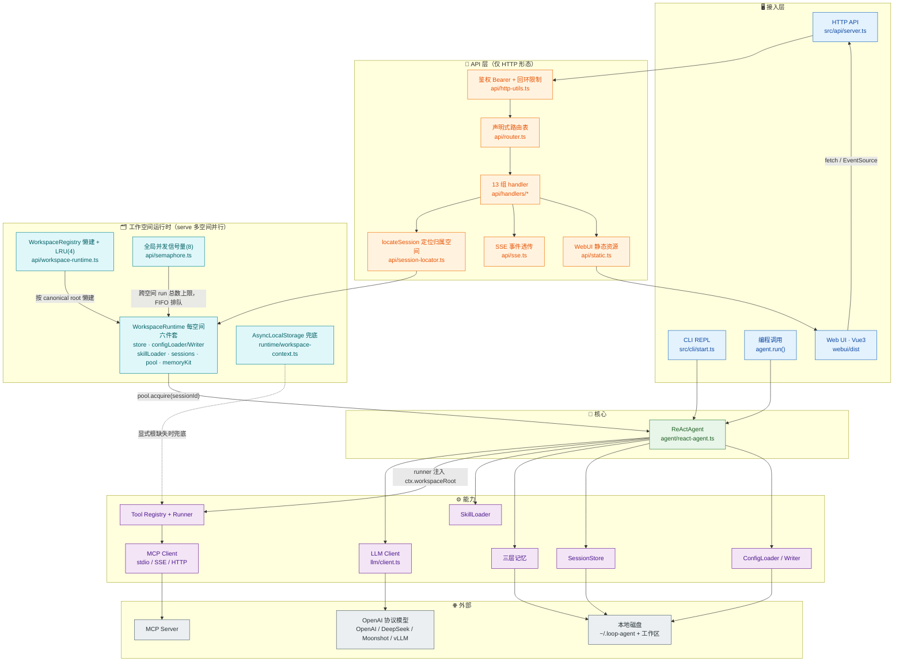
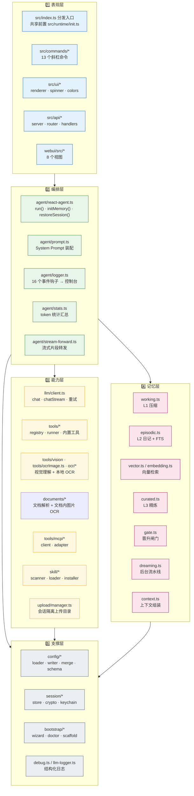
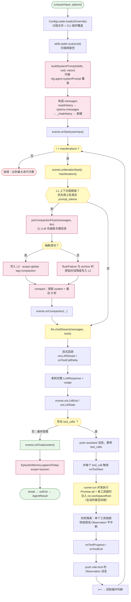
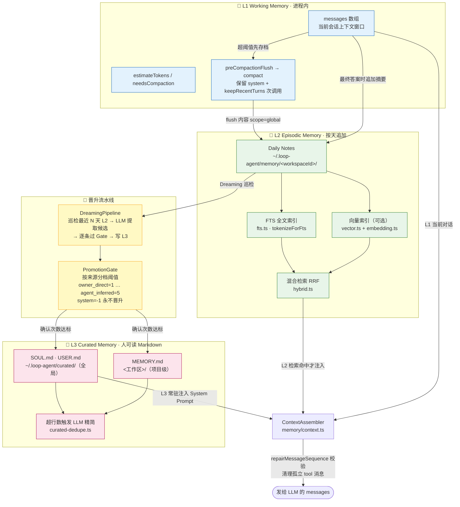
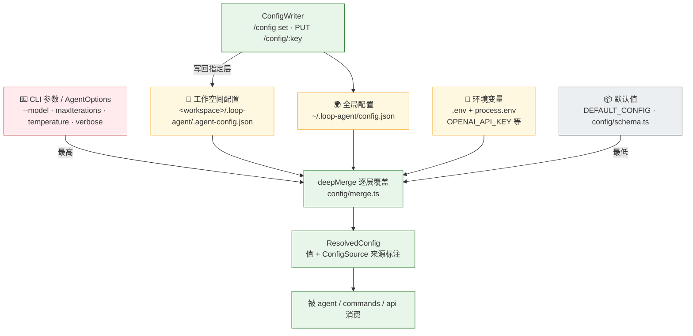
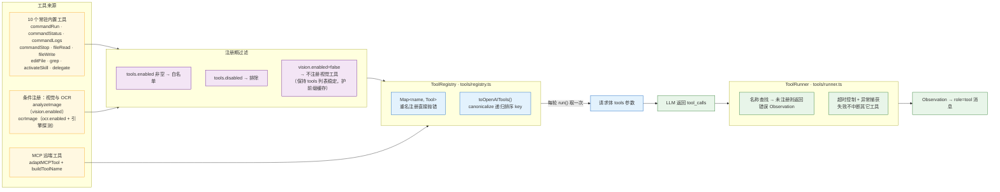
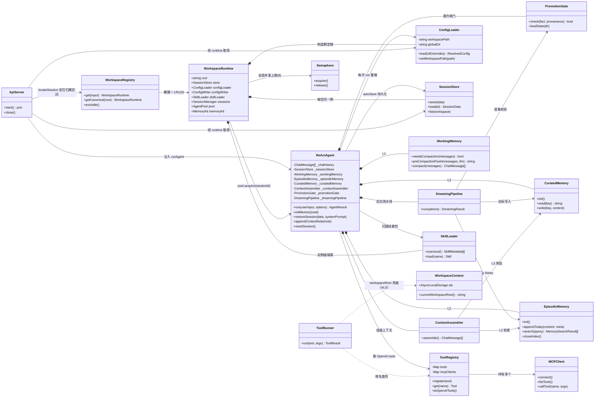

# 🧩 架构图集（Mermaid）

> 本文用 Mermaid 绘制本项目的**结构类图**——分层架构、ReAct 循环、三层记忆、配置合并、工具装配、核心类关系。
>
> 一次 `run()` 的内部控制流见 [图 3](#3️⃣-react-循环控制流)；这边画的是**系统长什么样**。
> 所有图均以 `src/` 实际代码为准（标注了对应文件），可直接当阅读源码的地图用。
>
> 相关文档：[架构设计](readme/zh/architecture.md) · [记忆管理](readme/zh/memory-management.md) · [工具扩展](readme/zh/tool-extension.md) · [配置管理](readme/zh/configuration.md)

---

## 图索引

| # | 图 | 类型 | 回答什么问题 |
|---|---|---|---|
| 1 | [系统全景](#1️⃣-系统全景四种接入形态) | flowchart | 一个仓库怎么跑出四种形态？谁复用谁？ |
| 2 | [分层架构](#2️⃣-分层架构) | flowchart | 代码分成哪几层，依赖方向如何？ |
| 3 | [ReAct 循环](#3️⃣-react-循环控制流) | flowchart | 一轮对话内部到底怎么转？ |
| 4 | [三层记忆](#4️⃣-三层记忆数据流) | flowchart | L1/L2/L3 各自存什么、落到哪个文件？ |
| 5 | [配置分层合并](#5️⃣-配置分层合并) | flowchart | 同一个配置项，谁压过谁？ |
| 6 | [工具装配](#6️⃣-工具装配与调用链) | flowchart | 10 个内置工具 + MCP 工具怎么进 `tools` 参数？ |
| 7 | [核心类关系](#7️⃣-核心类关系) | classDiagram | 核心类之间谁持有谁？ |

---

## 1️⃣ 系统全景：四种接入形态

同一个 `ReActAgent`，被四个入口以不同方式复用；`src/api` 是解耦点——CLI 走进程内直连，Web/第三方走 HTTP。



**读图要点**

- `--serve` 时 **WebUI 与 API 同端口**：`api/static.ts` 对未注册的 `GET` 先做静态回落，命中 `webui/dist` 就返回页面，否则再进路由（见 `server.ts` 请求流注释）。
- 请求处理链：**HTTP → 鉴权 → 路由 → handler → `locateSession`（按 sessionId 定位归属空间）→ WorkspaceRuntime → pool.acquire → agent → tool(ctx.workspaceRoot)**。每个空间由 `WorkspaceRegistry` 懒建独立 runtime（会话存储、配置、技能、记忆、Agent 池六件套，LRU 上限 4），互斥只约束**同空间同会话**，跨空间 run 并行互不影响；进程级 `Semaphore(8)` 限制全局并发 run 总数（FIFO 排队不拒绝）。
- 工具路径基准：`runner.run` 显式注入 `ctx.workspaceRoot`（会话所属空间根，优先）；漏改的深层代码由 `AsyncLocalStorage`（`runtime/workspace-context.ts`）兜底——进程级 `process.chdir` 已全量移除。
- CLI 与 API 仍共享进程级 `MCPManager` 单例（MCP server 的 cwd 固定为启动目录或配置显式值，不随空间切换）；`ConfigLoader/Writer` 与 `SkillLoader` 在 serve 侧按空间各持实例，CLI 单空间模式行为不变。

---

## 2️⃣ 分层架构

依赖方向**自上而下单向**：上层知道下层，下层不知道上层（`agent/` 不 import `api/`，`memory/` 不 import `agent/`）。



**两条不变量**（改代码时值得守住的边界）

1. `api/handlers/*` 只依赖 `HandlerContext` 里的接口，不 import 具体单例 → 单测可注入 `fake runAgent` 与临时目录。
2. `memory/*` 通过 `ILLMClient` 接口拿 LLM，不直接 import `llm/client.ts` → 记忆模块可以脱离真实网络单测。

---

## 3️⃣ ReAct 循环控制流

`agent/react-agent.ts` 的 `run()` 主循环（L420 起），对应 [architecture.md](readme/zh/architecture.md) 里那张 ASCII 流程图：



**三个容易踩的细节**（都写在这段代码里）

| 细节 | 说明 | 源码 |
|---|---|---|
| 阈值判定优先用**真实 token** | `_lastContextTokens`（上轮 `prompt_tokens`，含 system/工具/L2/L3 注入）优先；缺失才回退「字符数/4」估算——中文会被低估导致压缩不触发 | `react-agent.ts` L431 |
| 压缩不是截断 | 先 `preCompactionFlush` 让 LLM 产出结构化笔记写进 L2，**再** `compact` 丢消息；抽取失败时按 `flushFailure` 策略降级存档 | `memory/working.ts` |
| 工具并发但事件串行 | 先统一 `onToolStart`，再 `Promise.all` 执行，最后统一 `onToolProgress`/`onToolEnd` | `react-agent.ts` L596 |

---

## 4️⃣ 三层记忆数据流



**注入策略是「按价值付费」**

| 层 | 何时进上下文 | 代价 |
|---|---|---|
| L3 | **每轮常驻**（System Prompt 的 memory section） | 固定占用，所以必须短、必须是人可读的结论 |
| L2 | **只在查询命中时**注入（内置停用词过滤「继续」「好的」这类空话，避免无谓检索） | 变动成本，命中才付费 |
| L1 | 当前对话本身 | 超阈值即压缩 |

> 「常驻的必须精炼，海量的必须按需」——这是三层设计的根因，也是 `gate.ts` 里 `system: -1`（脚手架永不晋升）存在的理由。

---

## 5️⃣ 配置分层合并



**两个行为细节**

- `.env` 加载是**幂等且不覆盖**已存在的 `process.env`：命令行/系统环境变量优先级天然高于 `.env` 文件（`loader.ts` L33）。
- `load(cliOverride)` 在**每次 `run()` 都重新执行**，所以 `/model use` 切模型、`/config set` 改配置都能在下一轮立即生效，不需重启进程。

---

## 6️⃣ 工具装配与调用链



**为什么 `canonicalize` 要排 key？** DeepSeek 等模型的**前缀缓存**要求请求体字节级一致；`JSON.stringify` 的对象 key 顺序不稳定会让 `tools` 段每次都 miss 缓存。同样的考虑也解释了「视觉未启用时不注册视觉工具」——避免 `tools` 数组长度抖动。

---

## 7️⃣ 核心类关系



**图例**：`-->` 关联 · `*--` 组合（记忆组件生命周期跟随 agent）· `..>` 依赖（不持有）。

`ApiServer` 对 `ReActAgent` 只依赖 **`runAgent` 函数签名**而非类本身——这正是 `server.ts` 里 `ApiServerDeps.runAgent` 那层依赖注入 seam，让 API 单测能塞一个假的 `runAgent` 跑真实 HTTP server（`port: 0`）。

---

## 📁 附：落盘位置速查

```text
~/.loop-agent/                     ← 全局层（跨项目共享）
├── config.json                    ← 全局配置
├── .env / 密钥
├── curated/                       ← L3：SOUL.md · USER.md
├── memory/<workspaceId>/          ← L2：按天 Daily Notes + FTS/向量索引
├── uploads/<sessionKey>/          ← /upload 会话隔离上传目录
├── sessions/                      ← 会话（AES-256-GCM 加密）
└── logs/                          ← DEBUG=true 时的结构化日志

<workspace>/.loop-agent/           ← 工作区层（仅本项目）
├── .agent-config.json             ← 工作区配置（优先级高于全局）
├── skills/                        ← 技能包目录
└── MEMORY.md                      ← L3：项目级精炼记忆
```

对应源码：`react-agent.ts` `initMemory()`（L197/L223/L225）、`upload/manager.ts` `defaultUploadsRoot()`。

---

## 🔧 维护约定

1. **图必须跟着代码走**：改动 `run()` 的控制流、记忆层落盘路径、或 API 路由时，顺手更新对应图——本文件所有节点都标了源码文件名，方便核对。
2. **不在图里放会漂移的数字**（迭代上限、阈值、文件数），只写机制；确需数字时用配置项名代替（如 `maxIterations`）。
3. 渲染方式：GitHub/GitLab 自动渲染 Mermaid；VS Code 装 *Markdown Preview Mermaid Support*；本地 `webui` 已依赖 `mermaid@12`。
