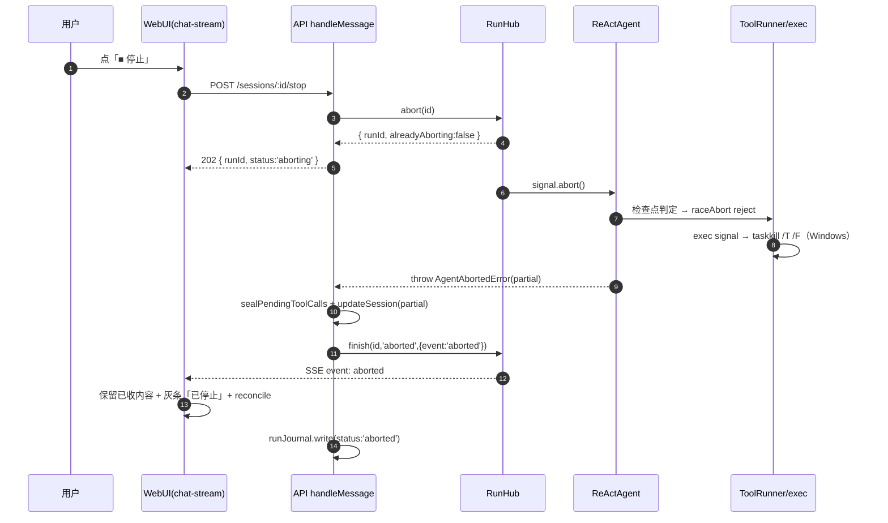

# 设计方案 20261021-002：WebUI 对话运行态增强（取消 / 并发 / 多标签页 / 通知 / 运行态持久化）

| 项目 | 内容 |
| --- | --- |
| 建议编号 | 20261021-002（台账：`docs/optimization_suggestions/优化建议.md`） |
| 承接方案 | `docs/optimization_suggestions/设计方案-20261021-001+WebUI对话后台运行与跨页面保持.md`（其 P0 后台保活、P1 体验补全已实施；本方案即其"P2 可选增强"五项的展开） |
| 文档状态 | **已确认（2026-10-21）**：D1 选 A（真取消，且**不保留**侧栏"停止查看"入口）、D3 选 A（中断标记不进消息数组）；任务拆分见 `docs/tasks/optimizations/00-总任务计划-20261021-002.md`；仅设计，未做任何代码改动 |
| 编写日期 | 2026-10-21 |
| 影响层 | 服务端（`src/agent`、`src/tools`、`src/llm`、`src/api`）+ 前端（`webui/src`） |
| 推进顺序 | 1 → 2 → 3 → 4 → 5（1 是 2 的安全前提，必须先行） |

---

## 一、背景与目标

### 1.1 需求来源

20261021-001 让 run 与 HTTP 连接解耦（`RunHub` + attach 续传），解决了"切页面/刷新即丢流"。但由此留下一个副作用：**前端"停止"只是断开自己那条 SSE，服务端 run 完全不受影响**。用户在 WebUI 上点停止后，token 继续烧、工具继续跑（可能还在写文件）、侧栏运行点仍在转。本方案把 001 标记为"P2 可选增强"的五项补齐，并明确"真正取消"是其余多项的安全前提。

### 1.2 现状结论（先回答"是不是这样"）

| # | 建议描述 | 核对结果 | 证据 |
| --- | --- | --- | --- |
| 1 | `stop()` 只 abort 前端 fetch，服务端照常执行 | **成立**。前端 `stop()` 只 abort `controller`/`attachCtrl`，注释亦自述"服务端 run 不受影响，P2 再做服务端取消" | `webui/src/chat-stream.ts:679-684`；`App.vue:47-50` 提示"服务端将照常完成并保存" |
| 1 | `AgentOptions` 没有 `signal` | **成立**。`AgentOptions` 只有 model/temperature/messages/resetHistory/spinner/onSnapshot 等，无取消入口 | `src/types.ts`（`interface AgentOptions`） |
| 1 | `ToolRunner.withTimeout` 超时后原 Promise 仍在执行 | **成立**，注释已明说"无法真正取消" | `src/tools/runner.ts:65-85` |
| 1 | `commandRun` 只把 timeout 交给 `exec` | **成立**，无 `signal`、无进程树兜底 | `src/tools/commandRun.ts:18-38` |
| 1 | 服务端无取消端点 | **成立**。路由表只有 `GET/POST/DELETE /sessions*`、`/messages`、`/stream`，无 `stop` | `src/api/router.ts:81-95` |
| 2 | `deps.runAgent` 绑定 `agent` 单例 | **成立** | `src/api/bootstrap.ts:36`；`src/agent/react-agent.ts:939 export const agent` |
| 2 | 单例内部状态会被多会话互相覆盖 | **成立**：`_chatHistory`/`_currentSessionId`/`_workingMemory`/`_episodicMemory`/`_curatedMemory` 均为实例字段 | `src/agent/react-agent.ts:72-96` |
| 2 | 现在靠 `entry.inFlight` 做会话级互斥、`hasInFlight()` 做全局互斥 | **成立** | `src/api/session-manager.ts:22-23,49-54`；`src/api/handlers/messages.ts:38-41` |
| 2 | 前端另有"另一会话在跑"的发送拦截 | **成立** | `webui/src/views/ChatView.vue:298-323` |
| 2 | `cachedKit` 是全局单例而非按 workspace | **成立** | `src/api/memory-kit.ts:92-103` |
| 3 | `chat-stream` 是各标签页独立模块单例 | **成立**：`states` 为模块级 `reactive(Map)`，无任何跨标签页通道 | `webui/src/chat-stream.ts:85` |
| 4 | 后台完成只有页内 toast | **成立**：`finishRun` 里仅 `showToast('后台会话已生成完成')` | `webui/src/chat-stream.ts:307-322` |
| 5 | RunHub 全在内存、终态保留 60s，重启后无法判断"上次是否跑一半" | **成立**：`runs` 是内存 `Map`，`RUN_RETAIN_AFTER_FINISH_MS = 60_000` | `src/api/run-hub.ts:17,68` |

补充两条建议未提但会卡住实现的现状：

- `GET /sessions/:id/stream` 的关流条件是 `done`/`fatal` 两种终态，新增 `aborted` 终态必须同步加入，否则 attach 连接会悬挂到 keep-alive。`src/api/handlers/stream.ts:69`
- `RunHub.publish` 在 `status !== 'running'` 时直接返回 0，因此**终态事件必须在 `finish()` 内、置状态之前发布**（现有 `finish` 已如此），`aborted` 复用该顺序即可，无需改动。

### 1.3 差距清单

1. **无取消语义**：`AgentOptions` / `Tool` / `LLM chatStream` / `exec` / `RunHub` 五处都没有 abort 通道。
2. **无 run 级独占**：并发靠的是"全局只允许一个 run"，而非"每个 run 独占一份 agent + 一次事件流"。
3. **无跨标签页通道**：派生状态（运行点、未读、标题计数）各标签页各算各的。
4. **无系统级提醒**：用户切到别的应用后完全无感。
5. **无 run 生命周期落盘**：崩溃/重启后只能看到"半截回答"，无法解释原因。

### 1.4 目标

| 编号 | 目标 | 可验证方式 |
| --- | --- | --- |
| G1 | 停止按钮真正终止服务端 run | 停止后 5s 内：无新事件、`prompt_tokens` 不再增长、`tasklist` 中该命令子进程树消失 |
| G2 | 停止后已产生的部分输出不丢 | 刷新页面仍能看到已生成内容，并显示"已停止"注记 |
| G3 | 同一工作空间内两个会话可同时流式，消息不串 | 两会话并发送达，各自 SSE 只收到自己的事件，落盘各自独立 |
| G4 | 多标签页运行态/未读一致 | A 页发起，B 页 1s 内出现运行点；A 页清未读，B 页红点消失 |
| G5 | 后台完成可被系统通知 + 提示音感知，且不重复打扰 | 仅 `document.hidden`/无焦点时通知；前台完成不弹 |
| G6 | 重启后能识别"上次被中断" | 强杀进程再启动，会话显示"上次运行被中断"，侧栏有断点标记 |

### 1.5 设计原则

1. **取消是横切能力，早注入早省事**：`signal` 从 API 层一路贯穿到 `exec`，而不是在每层各写一套超时。
2. **复用既有骨架**：RunHub 的事件缓冲/cursor/fan-out、`onSnapshot` 节流落盘、`reconcile` 历史对齐都可直接复用，不重造。
3. **状态单向**：服务端是唯一事实源；前端所有"运行态"都由事件或 `GET /sessions/:id` 派生，跨标签页只广播派生状态，不传消息体。
4. **不污染 LLM 上下文**：中断标记走 `run.json` 与前端渲染，**不往消息数组里塞合成 assistant 消息**（会被记忆/压缩/落盘反复复制）。
5. **默认零打扰**：通知权限仅在用户手势中请求；声音/系统通知各一个开关且持久化。
6. **写盘不阻塞主流程**：`run.json`、run 日志全部 best-effort，失败只记日志。

### 1.6 非目标

- 不做**跨工作空间**并发（受 `process.chdir` 进程级状态限制，单列 2b，本方案只留接口位）。
- 不做 run 的持久化续跑（崩溃后从断点继续生成）——只做"识别与提示"。
- 不做多用户/多租户隔离，不做审计。
- 不引入新运行时依赖（进程树 kill 用系统 `taskkill`，跨标签页用原生 API）。

---

## 二、现状架构（改造前）

### 2.1 取消链路：四处断点

```
用户点击停止
  └─ chat-stream.stop(id)              ← webui/src/chat-stream.ts:679
       ├─ controller.abort()           → 仅断掉 POST /messages 的读流
       └─ attachCtrl.abort()           → 仅断掉 GET /stream 的读流
            ✗ 服务端无感知
                 └─ handleMessage 的 entry.inFlight 继续 await agent.run(...)（messages.ts:92-151）
                      └─ ReActAgent.run 循环继续（react-agent.ts:478-798）
                           ├─ streamLLM 继续流式收 token（react-agent.ts:654）
                           └─ runner.run(tool, args) 继续执行（react-agent.ts:759）
```

四处断点：`AgentOptions`（无 signal）→ `ToolRunner`（无 signal、withTimeout 只 reject 不取消）→ `commandRun`（`exec` 无 signal）→ `RunHub`（无 controller、无 `aborted` 状态）。

### 2.2 agent 单例与互斥

- 单实例 `agent` 被 `deps.runAgent` 闭包捕获（`bootstrap.ts:36`），所有会话共享 `_chatHistory`、`_workingMemory`、`_episodicMemory`、`_currentSessionId`。
- 因此现状用两道锁兜底：`entry.inFlight`（同会话）+ `hasInFlight()`（切工作空间前必须全局空闲，`messages.ts:31-35`、`sessions.ts:131+`）。
- 记忆侧 `cachedKit` 也是进程级单例（`memory-kit.ts:92`），切换工作空间时靠 `resetMemoryKitCache()` 重置。

### 2.3 前端状态

`chat-stream.ts` 的 `states` 是模块级 `reactive(Map<sessionId, SessionStreamState>)`，只在**当前标签页**内共享。`App.vue` 的标题计数（`runningCount`/`unreadCount`）与侧栏运行点都取自该 Map，因此天然是"每标签页一套"。

### 2.4 通知

`finishRun` 的提醒只有一条 `showToast`（页内），且不分前台/后台。

### 2.5 运行态

RunHub 的 `runs: Map<string, RunState>` 全在内存（`run-hub.ts:68`），终态 60s 后删除。进程退出即全丢，重启后 `GET /sessions/:id` 的 `run` 为 `null`，前端只能按"空闲"处理。

---

## 三、目标架构（改造后）

```
                    ┌──────────────── 浏览器标签页 A ────────────────┐
                    │ ChatView / App                                 │
                    │   chat-stream（会话状态机）                     │
                    │     ├─ sendMessage → POST /messages (SSE)      │
                    │     ├─ attach     → GET  /stream?cursor=       │
                    │     ├─ abortRun   → POST /sessions/:id/stop ★  │
                    │     ├─ notify.ts（系统通知 + WebAudio 提示音）★ │
                    │     └─ tab-sync.ts（BroadcastChannel/storage）★│
                    └───────────┬───────────────────┬────────────────┘
                                │ SSE               │ 跨标签页广播（只传派生状态）
        ┌───────────────────────▼──────────┐   ┌────▼──────────────┐
        │ API 层                            │   │ 标签页 B / C       │
        │  handleMessage ─┐                │   │  收 run-started →  │
        │  handleStop ★   ├→ RunHub ★      │   │     attach()       │
        │  handleAttach ──┘   ├ runs Map   │   │  收 run-finished → │
        │                     ├ buffer/seq │   │     reconcile()    │
        │                     └ AbortCtrl★ │   └───────────────────┘
        └───────┬──────────────────────────┘
                │ deps.runAgent(sessionId, input, options{signal}★)
        ┌───────▼────────────────────────────────────────────────────┐
        │ AgentPool ★（按 sessionId 租用 ReActAgent，LRU 2~4）        │
        │   └ ReActAgent.run：迭代/LLM/工具/压缩/记忆 五类检查点 ★     │
        │        ├ streamLLM(messages, tools, {model,temp,signal}★)   │
        │        └ ToolRunner.run(tool,args,{signal}★)                 │
        │             └ commandRun：exec({signal}) + killProcessTree ★ │
        └───────┬────────────────────────────────────────────────────┘
                │ 共享（按 workspaceId）
        ┌───────▼──────────────┐        ┌─────────────────────────────┐
        │ WorkspaceMemoryRegistry★│      │ RunJournal ★                │
        │  按 workspaceId 复用 kit │      │  <store.path>/runs/<id>.json │
        └──────────────────────┘        │  + logs/runs-YYYY-MM-DD.jsonl│
                                        └─────────────────────────────┘
```

★ = 本方案新增/改造点。关键设计取舍：

- **不引入 worker/多线程**：并发靠"每个 run 一份 agent 实例"，共用同一 Node 事件循环，与现有 `Promise.all` 工具并发语义一致。
- **取消靠 AbortSignal 单通道**：不在每层各造一套中断标志，避免状态分叉。

---

## 四、详细设计

### 4.1 可取消的 run（P0，其余项的安全前提）

#### 4.1.1 类型与契约

`src/types.ts`：

```ts
/** 工具执行上下文（新增，可选第二参，向后兼容） */
export interface ToolContext {
  /** run 级取消信号：贯穿 AgentOptions.signal */
  signal?: AbortSignal;
  /** 工作空间根（2b 用；本方案先透传，commandRun 默认 cwd 待 2b 启用） */
  workspaceRoot?: string;
}

export interface Tool {
  name: string;
  description: string;
  parameters: Record<string, unknown>;
  /** 第二参可选：既有工具签名 (args) => Promise<string> 仍合法 */
  execute: (args: Record<string, unknown>, ctx?: ToolContext) => Promise<string>;
  timeoutMs?: number;
}

export interface AgentOptions {
  // ...既有字段
  /** run 级取消信号；aborted 后 Agent 抛 AgentAbortedError（携带 partial） */
  signal?: AbortSignal;
}

/** 中止载体：携带已产生的部分结果，供 API 层落盘 */
export class AgentAbortedError extends Error {
  readonly aborted = true;
  constructor(readonly partial: AgentPartialResult) {
    super('run aborted by user');
    this.name = 'AgentAbortedError';
  }
}

export interface AgentPartialResult {
  messages: ChatMessage[];
  transcript: ChatMessage[];
  steps: AgentStep[];
  iterations: number;
}
```

> 兼容性：`Tool.execute` 增加可选参对现有 6 个内置工具、4 个视觉工具、MCP 适配器（`mcp/adapter.ts:32 async execute(args)`）**全部零改动**。

#### 4.1.2 ReAct 循环检查点

在 `src/agent/react-agent.ts` 的 `run()` 里加一个内部工具函数与五类检查点：

```ts
const signal = options.signal;
let aborted = false;
signal?.addEventListener('abort', () => { aborted = true; }, { once: true });
const throwIfAborted = (iteration: number): void => {
  if (!signal?.aborted && !aborted) return;
  throw new AgentAbortedError({
    messages: [...messages],
    transcript: [...transcript],
    steps: [...steps],
    iterations: iteration,
  });
};
```

| 检查点 | 位置 | 说明 |
| --- | --- | --- |
| C1 迭代入口 | `for (let i = 0; ...)` 循环体首行（`react-agent.ts:478` 之后） | 阻止"下一轮"启动 |
| C2 LLM 调用前 | `streamLLM` 前（`:654` 上方） | 避免空转一次请求 |
| C3 工具执行前 | `callItems` 组装后、`runner.run` 前（`:743-759`） | 不再启动新工具 |
| C4 压缩前后 | `planCompaction` 判定后、`preCompactionFlush` 前后（`:509-620`） | 压缩是额外 LLM 调用，最容易"停不下来" |
| C5 记忆写入前 | 最终回答写 L2 前（`:709`）、工具结果写 L2 前（`:783`） | 不产生半条记忆 |

> C3 是"是否真正停得下来"的关键：工具是最长耗时环节，仅靠 C1/C2 会让用户以为"点了没反应"。

#### 4.1.3 LLM 流式取消

`src/llm/client.ts`：

```ts
export interface ChatOptions {
  model?: string;
  temperature?: number;
  maxTokens?: number;
  signal?: AbortSignal;   // 新增
}

// chatStream 内（约 :378）
const stream = await client.chat.completions.create(params, { signal: options.signal });
```

三个必须处理的行为（已核对 openai-node 源码与文档）：

1. **`create(params, { signal })` 是官方支持的取消方式**；`signal` abort 后 SDK 内部会 `reader.cancel()` 并结束迭代（`openai-node/src/core/streaming.ts`）。
2. **abort 后 `for await` 是"正常 return"而不是抛错**——SDK 在 `catch` 中把 `isTransportAbortError` / `signal.aborted` 的异常吞掉。因此**必须在循环结束后自己判**：
   ```ts
   for await (const chunk of stream) { /* ... */ }
   if (options.signal?.aborted) throw new AgentAbortedError(...); // 由 agent 层统一构造
   ```
   否则会出现"abort 了但 `resp` 被当成正常响应，Agent 拿空响应往下走"的静默错误。
3. **abort 不能进重试分支**：现有 `chatStream` 的 catch 会把错误记入 `streamError` 并抛给上层的 `retry()` 逻辑；`AbortError`/`APIUserAbortError` 必须在进入 `retry` 前短路返回，否则取消会被当成网络抖动重试 3 次（等于没取消）。
   ```ts
   if (options.signal?.aborted || e?.name === 'AbortError' || e?.name === 'APIUserAbortError') {
     return; // 交由调用方按 signal.aborted 判定，不走 retry
   }
   ```

已知次要问题（记录不修）：openai-node 的 `fetchWithTimeout` 在部分版本未移除 abort 监听器（[issue #1811](https://github.com/openai/openai-node/issues/1811)），长生命周期进程里 abort 次数很多时会出现 `MaxListenersExceededWarning`；本项目 run 粒度上可忽略，必要时在 `process.setMaxListeners` 层面不提权、仅在压测中观察。

#### 4.1.4 工具取消

`src/tools/runner.ts`：

```ts
export interface RunOptions {
  timeout?: number;
  signal?: AbortSignal;   // 新增
}

async run(tool: Tool, args: Record<string, unknown>, options: RunOptions = {}): Promise<string> {
  const timeout = options.timeout ?? tool.timeoutMs ?? 30000;
  const signal = options.signal;
  try {
    const ctx: ToolContext = { signal };
    const exec$ = tool.execute(args, ctx);
    const result = await this.withTimeout(
      signal ? this.raceAbort(exec$, signal) : exec$,
      timeout,
    );
    // ...
  } catch (e) {
    if (e instanceof AgentAbortedError) throw e;     // 取消要冒泡，不能变成 Observation
    // ...既有超时/失败归一化
  }
}

private raceAbort<T>(p: Promise<T>, signal: AbortSignal): Promise<T> {
  if (signal.aborted) return Promise.reject(new AgentAbortedError(/* 由 agent 层补 partial */));
  return new Promise<T>((resolve, reject) => {
    const onAbort = (): void => reject(new AgentAbortedError());
    signal.addEventListener('abort', onAbort, { once: true });
    p.then(
      (v) => { signal.removeEventListener('abort', onAbort); resolve(v); },
      (e) => { signal.removeEventListener('abort', onAbort); reject(e); },
    );
  });
}
```

> 语义决策：**取消必须冒泡为异常**，不能像普通工具失败那样变成 Observation 字符串。否则 ReAct 会把"用户取消了"当成"工具执行失败"，再花一轮 token 去"换个思路重试"。这是本方案对现有 `ToolRunner` 语义（"异常不抛出"）的唯一例外，需在代码注释中显式说明。

`src/tools/commandRun.ts`：

```ts
async execute(args, ctx) {
  const cmd = String(args.command);
  const cwd = args.cwd ? String(args.cwd) : ctx?.workspaceRoot;  // 2b 前默认 undefined（沿用 process.cwd()）
  const timeout = Number(args.timeout ?? 30000);

  return new Promise((resolve) => {
    const child = exec(
      cmd,
      { cwd, timeout, maxBuffer: 1024 * 1024, signal: ctx?.signal, windowsHide: true },
      (err, stdout, stderr) => { /* 既有归一化逻辑不变 */ },
    );
    // Windows：exec 走 cmd.exe，abort 只杀 shell，孙进程会残留 → 需按进程树兜底
    ctx?.signal?.addEventListener('abort', () => {
      void killProcessTree(child.pid);
    }, { once: true });
  });
}
```

新增 `src/tools/process-tree.ts`（约 30 行，零依赖）：

```ts
import { execFile } from 'node:child_process';
import { promisify } from 'node:util';
const execFileAsync = promisify(execFile);

/**
 * 尽力终止进程树。
 * - Windows：`taskkill /pid <pid> /T /F`（系统无 POSIX 进程组，必须显式枚举子树）
 * - POSIX：优先负 pid 杀进程组（需 spawn 时 detached: true），否则退化为单 pid
 * 失败一律静默：取消路径不应因为清理失败而改变用户可见结果。
 */
export async function killProcessTree(pid?: number, signal: NodeJS.Signals = 'SIGKILL'): Promise<void> {
  if (!pid || pid <= 0) return;
  if (process.platform === 'win32') {
    await execFileAsync('taskkill', ['/pid', String(pid), '/T', '/F']).catch(() => {});
    return;
  }
  try { process.kill(-pid, signal); }
  catch { try { process.kill(pid, signal); } catch { /* 已退出 */ } }
}
```

依据（已检索）：Windows 没有 POSIX 进程组，`ChildProcess.kill()` 只打直接子进程，子树需 `taskkill /T /F`；execa、npm `@npmcli/promise-spawn`、pnpm 均采用该做法；并且**必须趁树还完整时执行**（先杀直接子进程会让后代成为孤儿，`taskkill` 再也枚举不到）。Node 至今未内置 `killTree`（[nodejs/node#64406](https://github.com/nodejs/node/issues/64406) 仍 open），所以自实现这段是当前唯一稳妥解。

#### 4.1.5 RunHub 增加 abort

`src/api/run-hub.ts` 改动（保持向后兼容，不改 `start()` 返回值）：

```ts
export type RunStatus = 'running' | 'done' | 'failed' | 'aborted';   // 新增 aborted

interface RunState {
  // ...既有字段
  controller: AbortController;      // 新增
  aborting: boolean;                // 新增：幂等标记
}

// start() 内：state.controller = new AbortController();

/** 供 handleMessage 取 signal 注入 AgentOptions */
signal(sessionId: string): AbortSignal | null {
  return this.runs.get(sessionId)?.controller.signal ?? null;
}

/**
 * 请求取消：无 run / 已非 running / 已在取消中 → null（幂等，不重复 abort）
 * 只负责"置位 + abort"，终态由持有 run 的调用方 finish(id,'aborted',...) 发布。
 */
abort(sessionId: string): { runId: string; alreadyAborting: boolean } | null {
  const state = this.runs.get(sessionId);
  if (!state || state.status !== 'running') return null;
  const alreadyAborting = state.aborting;
  state.aborting = true;
  if (!alreadyAborting) state.controller.abort(new Error('aborted by user'));
  return { runId: state.runId, alreadyAborting };
}
```

- `publish` 的 `status !== 'running'` 短路保持不动；`finish` 仍是"先 publish 终态再置状态"，因此 `aborted` 事件一定能下发且能被晚到订阅者回放。
- `dispose()` / `drop()` 需 `controller.abort()` 一次，避免服务关停时 run 悬空。

#### 4.1.6 新端点 `POST /sessions/:id/stop`

`src/api/router.ts` 增加一条：

```ts
{ method: 'POST', path: '/sessions/:id/stop', handler: (ctx, req, res, p) => handleStop(ctx, req, res, p.id) },
```

`src/api/handlers/stop.ts`（新文件）：

| 场景 | 状态码 | 响应体 |
| --- | --- | --- |
| 会话不存在（含跨工作空间都找不到） | 404 `not_found` | `{error:{code,message}}` |
| 无 run（从未运行 / 已过 60s 保留期 / 已结束） | **204** | 空（幂等：停止一个已停的会话不算错） |
| 有 running run，首次请求 | **202** | `{ runId, status: 'aborting' }` |
| 有 running run，重复请求 | **202** | 同上 + `alreadyAborting: true` |

实现要点：

- **不等待 `entry.inFlight`**：立即返回 202，前端靠 SSE 的 `aborted` 终态感知完成（否则"停止"按钮会卡在请求里）。
- 鉴权/跨空间校验逻辑沿用 `handleAttachStream` 的只读校验（`listAllWorkspaces` 扫一遍，不切空间）。
- 允许取消**非当前工作空间**的运行：run 只可能存在于其所属空间，而工作空间切换本身在 `hasInFlight()` 时已被禁（`messages.ts:31`、`sessions.ts`），所以实际只会命中当前空间的 run；此校验保留以防后续 2b 放开。

#### 4.1.7 部分结果落盘与 `aborted` 终态

`handleMessage` 的 `try/catch` 增一个分支（`messages.ts:92-151`）：

```ts
entry.inFlight = (async () => {
  try {
    const result = await deps.runAgent(message, runOptions);   // 签名见 4.2.2
    // ...既有成功路径
  } catch (e) {
    if (e instanceof AgentAbortedError || (e as {aborted?: boolean}).aborted === true) {
      const partial = (e as AgentAbortedError).partial;
      // ① 封口：assistant(tool_calls) 若缺对应 tool 响应，补合成结果，
      //    否则下一轮 messages 会触发 "tool must be response to preceding tool_calls"
      const sealed = sealPendingToolCalls(partial.messages);
      // ② 落盘（与成功路径同口径，transcript 供归档用）
      let stored: ChatMessage[] = sealed;
      try {
        stored = await deps.sessionStore.updateSession(id, sealed, message, { transcript: partial.transcript });
      } catch (err) {
        warnings.push(`会话持久化失败（已停止，部分输出仅存内存）: ${msg(err)}`);
      }
      entry.history = stored.filter((m) => m.role !== 'system' && m.is_compact !== true);
      // ③ 终态：aborted 事件 + Hub 状态 aborted
      ctx.runs.publish(id, 'warning', { level: 'warning', message: '已被用户停止（以下为已生成的部分输出）' });
      ctx.runs.finish(id, 'aborted', {
        event: 'aborted',
        data: { sessionId: id, durationMs: Date.now() - startedAt, iterations: partial.iterations,
                steps: partial.steps.length, partial: true },
      });
      if (stream) res.end();
      else sendJson(res, 200, { aborted: true, partial: true, iterations: partial.iterations });
      runJournal.write(sessionId, { status: 'aborted', finishedAt: Date.now() });
      return;
    }
    // ...既有失败分支（finish 'failed'）
  } finally { entry.inFlight = null; }
})();
```

`sealPendingToolCalls`（放 `src/api/abort-utils.ts` 或与 `repairMessageSequence` 同处）：

```ts
/** 为未被响应的 tool_call 补一条合成 tool 消息（内容标明取消），保证消息序自洽 */
export function sealPendingToolCalls(messages: ChatMessage[]): ChatMessage[] {
  const answered = new Set(messages.filter((m) => m.role === 'tool').map((m) => m.tool_call_id!));
  const out = [...messages];
  for (const m of messages) {
    if (m.role !== 'assistant' || !m.tool_calls?.length) continue;
    for (const tc of m.tool_calls) {
      if (!answered.has(tc.id)) {
        out.push({ role: 'tool', tool_call_id: tc.id, content: '（运行已被用户停止，该工具调用未完成）' });
      }
    }
  }
  return out;
}
```

> 为什么不只依赖既有 `repairMessageSequence`（`memory/context.ts:35`）？它只在 `restoreSession` 路径被调用（`react-agent.ts:153`），且策略是**删掉**孤立 tool / 剪掉未响应的 tool_calls；而"补合成结果"能保留"当时确实发起过这个工具"的信息，对用户看历史更友好，也让 `messages` 与 `transcript` 保持一致。两条路径不冲突：即便漏了，恢复时 `repairMessageSequence` 仍是兜底。

**为什么中断标记不进消息数组**（D3）：若追加 `{role:'assistant', content:'（已被用户停止）'}`，该消息会进入下一轮 LLM 上下文、参与压缩摘要、被归档去重逻辑反复匹配（见 `react-agent.ts:648-650` 关于"回写会破坏落盘锚点"的注释）。改为写到 `run.json`（4.5）+ 前端渲染灰条，零污染。

`src/api/handlers/stream.ts:69` 的终态集合同步扩展：

```ts
if (ev.event === 'done' || ev.event === 'fatal' || ev.event === 'aborted') { res.end(); cleanup(); }
```

#### 4.1.8 前端「停止」改造

`webui/src/chat-stream.ts` 新增：

```ts
export type AbortOutcome = 'aborting' | 'none' | 'error';

/**
 * 请求服务端取消当前 run（P0）。
 * - 202/204 都视为已受理：真正的收尾由 SSE 的 aborted 终态驱动；
 * - 请求失败（网络/404）时回退为纯本地 detach，保持 001 的行为，不让用户卡死。
 */
export async function abortRun(id: string): Promise<AbortOutcome> {
  try {
    const r = await api<{ runId?: string; status?: string } | null>(
      `/sessions/${encodeURIComponent(id)}/stop`,
      { method: 'POST' },
    ).catch((e) => { if ((e as {status?:number}).status === 204) return null; throw e; });
    if (!r) return 'none';
    return 'aborting';
  } catch {
    stop(id);          // 本地兜底：断开读流（服务端仍会跑完）
    return 'error';
  }
}
```

`applyEvent` 增 `case 'aborted'`：

```ts
case 'aborted': {
  const asst = currentAssistant(st);
  asst.lastEventAt = now;
  asst.streaming = false;
  asst.live = null;
  asst.aborted = true;                       // ChatMsg 新增字段
  asst.meta = `已停止 · ${(Number(d.durationMs ?? 0) / 1000).toFixed(1)}s · ${String(d.iterations ?? '?')} 轮`;
  finishRun(id, st, 'aborted');              // finishRun 增加 status 参数
  void reconcile(id);                        // 以落盘结果为准（部分输出）
  break;
}
```

`ChatView.vue`：

- `stopGen()`（`:354`）改为 `await abortRun(activeId)`，toast 文案改为「已请求停止（服务端正在收尾）」，失败时提示「停止请求失败，已断开本页连接」。
- 消息渲染：`m.aborted` 时在消息卡片底部追加灰条 ——「⏹ 已被用户停止，以上为已生成的部分输出」。
- 「■ 停止」按钮语义变更需在按钮 `title` 中体现：`停止本次运行（服务端将中断）`。

`App.vue:47` 的侧栏 `stopSession`：**随 D1 确认一并移除**（不再提供"停止查看"），侧栏运行点仅作展示；"停止"语义统一收敛到聊天页按钮（真取消）。

#### 4.1.9 运行时序



#### 4.1.10 边界与异常（必须逐条实现）

| 场景 | 期望行为 | 处理 |
| --- | --- | --- |
| 压缩中（`preCompactionFlush` 的额外 LLM 调用）取消 | 停止，且不落半条压缩记忆 | C4 检查点；`compaction` 事件发 `{failed:true, fallback:'aborted'}` 让前端撤掉 loading（`chat-stream.ts:415-441` 已能消费 `compaction`） |
| abort 与 done 竞争（模型刚输出完最后一 token） | 二者只生效一个 | 谁先到谁生效：`finish` 后 `status!=='running'`，另一方的 `publish` 返回 0；`abort()` 对非 running 返回 null |
| 重复点停止 | 幂等 | 202 + `alreadyAborting:true`；`entry.inFlight` 已置空后返回 204 |
| 停止一个空闲会话 | 204，前端提示"当前无运行" | 前端收到 `none` 时 toast 一次 |
| 工具已在跑且不可中断（如 `fileWrite` 写大文件） | race 先返回，工具自然跑完后结果被丢弃 | 记录 `debug.log('aborted tool still running: ...')`，不阻塞下一轮（下一轮不会启动，因为整个 run 结束） |
| 非流式请求被取消 | 200 + `{aborted:true}`，前端保留已回滚的输入? | 非流式没有中间输出，回滚乐观消息并提示「已停止（未产生输出）」 |
| 服务关停时仍有 run | 全部 abort，run.json 记 aborted | `RunHub.dispose()` 内 abort |
| 前端 abort 后立刻又发消息 | 允许；但 `entry.inFlight` 不为 null 时返回 409 `busy` | 既有逻辑不变 |

---

### 4.2 同工作空间多会话并发（P1）

#### 4.2.1 Agent 池

新增 `src/agent/agent-pool.ts`：

```ts
export interface AgentPoolOptions {
  /** 池容量上限（含 busy 实例），默认 4 */
  capacity?: number;
  /** 实例工厂（默认 new ReActAgent()） */
  create?: () => ReActAgent;
}

export class AgentPool {
  private readonly idle = new Map<string, { agent: ReActAgent; lastUsed: number }>();
  private readonly busy = new Set<string>();

  /** 租用：同 sessionId 复用（若空闲），否则从空闲池取最久未用的，再否则新建（超容量先淘汰最久未用的空闲实例） */
  async acquire(sessionId: string, init: (a: ReActAgent) => Promise<void>): Promise<ReActAgent>;

  /** 归还：busy 标记清除，实例回空闲池 */
  release(sessionId: string): void;

  /** 配置变更/切换工作空间时整体重建（旧实例逐个 dispose） */
  reset(): void;

  get size(): number;
}
```

`deps.runAgent` 签名变更（`src/api/server.ts` 的 deps 类型 + `bootstrap.ts`）：

```ts
// 旧：runAgent: (input, options) => agent.run(input, options)
// 新：
runAgent: (sessionId, input, options) => pool.withAgent(sessionId, (a) => a.run(input, options)),
```

`withAgent` 内部保证：`acquire → run → finally release`。**同 sessionId 串行**由 `entry.inFlight` 保证（`messages.ts:39`），池只需保证"空闲实例不被两个 session 同时拿到"。

#### 4.2.2 记忆按 workspace 共享

问题：`initMemory(process.cwd())` 会让每个 agent 各建一套 `EpisodicMemory`/`CuratedMemory`，而它们指向**同一个磁盘目录**（`memory-kit.ts:46-51` 用 `workspaceId(cwd)` 分目录）。两个实例同时写 index / state 文件必然互相踩（现状靠单 agent + 串行掩盖了）。

改法（`src/api/memory-kit.ts`）：

```ts
// 旧：let cachedKit: Promise<MemoryKit> | null = null;
const kits = new Map<string, Promise<MemoryKit>>();

/** 按 workspaceId 复用记忆子系统（同空间多 run 共享实例，避免重复写同一索引） */
export function getMemoryKit(cwd: string): Promise<MemoryKit> {
  const key = workspaceId(cwd);
  let p = kits.get(key);
  if (!p) { p = createMemoryKit(cwd, configLoader); kits.set(key, p); }
  return p;
}

export function resetMemoryKitCache(): void {
  kits.clear();   // 保留原语义：切空间/改配置时清空
}
```

`ReActAgent` 增注入入口（避免"agent 自建记忆"与"池共享记忆"二选一打架）：

```ts
/** 外部注入已初始化的记忆子系统（AgentPool 用）；与 initMemory 互斥，后调用者生效 */
async attachMemory(kit: MemoryKit | null, cwd: string): Promise<void>
```

`initMemory(cwd)` 内部改为：先尝试 `getMemoryKit(cwd)`（API 模式），CLI 模式保持自建（`process.cwd()` 唯一，无并发需求）。用注入的 `MemoryKit` 组装 `promotionGate`/`contextAssembler`/`memoryCallback`（与 `react-agent.ts:227-290` 现有装配顺序一致）。

#### 4.2.3 事件与快照

`events` / `onSnapshot` 本就按次注入（`messages.ts:59-90`），池化后天然隔离，无需改动。这正是 001 留下的红利。

#### 4.2.4 前端放开拦截

`ChatView.vue` 删除"另一会话正在生成"的拦截（`:298-305` `otherRunningSession`、`:318-323` 判断块），保留：

- 当前会话 `streaming` 时禁止再发（防同会话并发，服务端本就是 409）；
- 跨工作空间会话只读的限制不变（2b 前不放）。

侧栏可同时显示多个运行点（`isRunning(s.id)` 已按 sessionId 判断，天然支持）。

#### 4.2.5 2b（跨工作空间并发）单列，不在本方案实施

障碍：`process.chdir` 是进程级状态，`switchWorkspace`（`sessions.ts:131`）改 cwd 会影响 `skillLoader`、`configLoader`、`SessionStore`、工具相对路径（`commandRun` 的 `exec` 默认 cwd）。

预留接口（本方案只做类型占位，不接线）：

- `ToolContext.workspaceRoot`（4.1.1 已定义）→ 未来 `commandRun` 默认 cwd 取它。
- `SessionStore` 已支持 `new Store(path)` + `rebindWorkspace`；未来改为"每工作空间一个 store 实例"，不再依赖 `chdir`。

在 2b 完成前，**保留**"有运行中会话禁止切换工作空间"（`messages.ts:31-35`）。

---

### 4.3 多标签页状态同步（P2-1）

新增 `webui/src/tab-sync.ts`：

```ts
export type TabMsg =
  | { t: 'run-started'; id: string; runId?: string; at: number }
  | { t: 'run-finished'; id: string; status: 'done' | 'failed' | 'aborted'; durationMs?: number; at: number }
  | { t: 'unread-cleared'; id: string; at: number }
  | { t: 'session-dropped'; id: string; at: number };

export function postTab(msg: TabMsg): void;
export function onTab(fn: (m: TabMsg) => void): () => void;
```

通道实现：

- 首选 `BroadcastChannel('loop-agent')`（同源、不持久、消息事件不回到发送者）；
- 缺失时退回 `localStorage` + `storage` 事件（随机键 `__la__<ts>_<rand>`，写入后 ~500ms 删除，接收方 `JSON.parse` 后按 `at` 去重）。这是社区标准 polyfill 做法，代价是同步 API + 数百 ms 延迟，可接受。

消息语义（**只传派生状态，不传消息体**）：接收方只做"唤醒 + 一次对齐"，内容永远以服务端为准。

| 收到 | 本端行为 |
| --- | --- |
| `run-started` | 若本端该会话为 idle → `status='running'` 并 `attach(id)`（事件流只读，多标签页各自订阅互不影响） |
| `run-finished` | 若本端 `status==='running'` → `reconcile(id)`；若 `!chatViewMounted || activeSessionId!==id` → `st.unread = true`；触发 `finishHandlers`（App 刷新侧栏） |
| `unread-cleared` | `markRead(id)`（不广播回去，避免乒乓） |
| `session-dropped` | `drop(id)` + 从列表移除 |

发送点（`chat-stream.ts` 内三处）：

- `sendMessage` 进入 running 时 → `postTab({t:'run-started'})`
- `finishRun` → `postTab({t:'run-finished', status})`
- `markRead`（由 `setActiveSession` 调用，且此前是 unread）→ `postTab({t:'unread-cleared'})`
- `drop` → `postTab({t:'session-dropped'})`

`App.vue` 的 `onMounted` 里注册 `onTab`，`onUnmounted` 反注册；标题计数（`runningCount`/`unreadCount`）因状态已被同步而自动正确。

> 关于建议中提到的"同步 `lastSeq`"（D8）：`lastSeq` 是**每连接**的游标，跨标签页无意义；接收方用 `reconcile()`（全量对齐 + 内容一致则不闪）比游标续传更简单可靠。方案取"只传状态 + 触发对齐"。

---

### 4.4 系统通知与提示音（P2-2）

新增 `webui/src/notify.ts`：

```ts
export interface NotifySettings { system: boolean; sound: boolean; asked: boolean }

const KEY = 'loop-agent.notify';
export function getNotifySettings(): NotifySettings;
export function setNotifySettings(patch: Partial<NotifySettings>): void;

/** 仅在用户手势（点击开关）内调用：浏览器已禁止非手势权限请求 */
export async function requestNotifyPermission(): Promise<NotificationPermission>;

export interface DoneNotice {
  sessionId: string; title: string; status: 'done' | 'failed' | 'aborted';
  durationMs?: number;
}
/** 后台完成提醒：前台/有焦点时不打扰 */
export function notifyRunDone(n: DoneNotice): void;
/** WebAudio 双音短提示（无需音频资源） */
export function playChime(): void;
```

触发规则（在 `chat-stream.finishRun` 内）：

```ts
const background = document.hidden || !document.hasFocus();
if (background) {
  notifyRunDone({ sessionId: id, title: sessionTitle(id), status, durationMs });
  playChime();
} else {
  showToast('后台会话已生成完成');   // 保持 001 的页内提示
}
```

`notifyRunDone` 实现要点：

- `Notification.permission !== 'granted'` → 不发；若 `settings.asked === false`，改发一次性**页内提示条**（「后台完成提醒可开启系统通知 → 开启」按钮），点击按钮时才 `requestNotifyPermission()`。默认 `asked:false`，绝不自动弹权限框（Firefox 72+/Safari 早已禁止非手势请求）。
- 内容：`title = '会话已完成：<会话标题>'`，`body = '耗时 12.3s · 3 轮'`；`tag = sessionId`（同会话通知互相替换，避免刷屏），`silent: true`（声音由我们自己的 WebAudio 控制，避免双响）。
- 点击：默认行为是聚焦该通知关联的浏览上下文；我们显式处理 —— `onclick` 内 `window.focus(); location.hash = '#/chat'; clickSession(sessionId); n.close();`。
- 安全上下文：Notifications 需要 HTTPS 或 localhost。本项目 WebUI 默认 `http://127.0.0.1` → `localhost`/`127.0.0.1` 属于可用的"潜在可信来源"，但**若用户通过局域网 IP 访问 `http://192.168.x.x` 会不可用**，此时静默降级为仅提示音 + 页内 toast（在设置弹层里给一行说明）。

提示音：`AudioContext` 在首次用户手势（点开 🔔 开关）时创建并 `resume()`（否则自动播放策略会挂起），之后复用；播放时 `oscillator(880Hz→1320Hz)` 各 80ms、`gain 0.05`，避免突兀。

开关 UI：`ChatView` 输入区工具条（与「流式」勾选同级，`:558` 附近）加一个 🔔 按钮，点击弹小面板两项（系统通知 / 提示音），写入 localStorage。

---

### 4.5 运行态持久化与中断诊断（P2-3）

#### 4.5.1 `run.json`

新增 `src/api/run-journal.ts`：

```ts
export type RunJournalStatus = 'running' | 'done' | 'failed' | 'aborted' | 'interrupted';

export interface RunJournal {
  runId: string;
  sessionId: string;
  status: RunJournalStatus;
  startedAt: number;
  finishedAt?: number;
  /** 服务进程 id（诊断用） */
  pid: number;
  /** 进程启动 UUID：判断"是否跨进程残留"的唯一可靠依据 */
  bootId: string;
  /** 最后已下发事件的 seq（节流写入） */
  lastSeq: number;
  iterations?: number;
}

export function currentBootId(): string;                       // 服务启动时 randomUUID()，进程内常量
export function journalPath(store: SessionStore, id: string): string;
export async function writeJournal(store, id, patch): Promise<void>;   // 节流 500ms，失败静默
export async function readJournal(store, id): Promise<RunJournal | null>;
/** 启动扫描：bootId ≠ 当前 且 status==='running' → 改写为 'interrupted' */
export async function reconcileInterruptedOnBoot(store): Promise<number>;
/** 删除会话时清理 */
export async function dropJournal(store, id): Promise<void>;
```

- 路径：`<store.path>/runs/<sessionId>.json`（`store.path` 见 `session/store.ts:283`；与 `<id>.json`/`<id>.enc` 同目录，便于随会话一起清理）。
- 写入时机：`runs.start()` 后（status=running）、`persistSnapshot` 时（更新 `lastSeq`，与 30s 节流同频）、终态时（done/failed/aborted + finishedAt + iterations）。
- 所有写失败 `catch` 后 `debug.log`，不影响主流程（复用 001 的"节流快照失败不阻塞"风格）。

**中断判定为什么用 bootId 而不是 pid 存活探测**（D7）：

- pid 在重启后会被复用，`process.kill(pid, 0)` 可能误判"还活着"；
- 跨机器/容器场景 pid 语义更弱；
- `bootId`（每次进程启动生成的 UUID）+ `pid` 双因子：`bootId !== currentBootId()` 即"非本次进程写的"，必然中断。pid 仅作诊断信息展示。

#### 4.5.2 暴露给前端

- `GET /sessions/:id`（`handlers/sessions.ts:199-206`）：新增 `lastRun: await readJournal(store, id)`，与 `run: ctx.runs.snapshot(id)` 并列（`run` 是实时态，`lastRun` 是磁盘态）。
- `GET /workspaces`（`:165-171`）：每个 session 增加 `lastRun: { status, finishedAt } | null`（仅保留必要字段，控制 payload）。

#### 4.5.3 前端呈现

`chat-stream.fetchDetail`（`:231-253`）读取 `lastRun`：

- `lastRun.status === 'interrupted'` → 在时间线末尾插入一条**前端态**注记（不进消息数组）：

  ```ts
  { kind: 'note', text: '⚠ 上次运行被中断（服务已重启），以上为已保存的部分输出' }
  ```

  实现方式：`SessionStreamState` 增加 `note?: string`，由 `ChatView` 在消息列表尾部渲染，`reconcile()` 时保留。
- `lastRun.status === 'aborted'` → 提示「上次运行由用户停止」。
- 侧栏：`s.lastRun?.status === 'interrupted'` 时在会话名后显示 `⚠`（`title="上次运行被中断"`）。

#### 4.5.4 run 日志（诊断）

新增 `src/api/run-log.ts`（约 40 行，复用 `src/llm-logger.ts` 的目录约定与 `writeJsonl` 风格，不改造它以免影响既有 LLM 日志行为）：

- 路径：`~/.loop-agent/logs/runs-YYYY-MM-DD.jsonl`（`llm-logger.ts:28,57-59` 同目录、同命名风格、同按日切分）。
- 每行：`{ ts, sessionId, runId, event: 'start'|'finish'|'abort'|'interrupted'|'failed', durationMs?, iterations?, status }`。
- 价值：事后能回答"这次 run 是正常结束、被杀、还是被中断"，并和 `llm-*.jsonl` 的 token/耗时对账。

---

## 五、接口与数据模型变更汇总

### 5.1 端点

| 方法 | 路径 | 状态 | 说明 |
| --- | --- | --- | --- |
| POST | `/sessions/:id/stop` | **新增** | 204 无运行 / 202 已受理 / 404 会话不存在 |

### 5.2 既有端点字段扩展

| 端点 | 变更 |
| --- | --- |
| `GET /sessions/:id` | + `lastRun: RunJournal \| null` |
| `GET /workspaces` | 每 session + `lastRun: {status, finishedAt} \| null` |
| `GET /sessions/:id/stream` | 终态集合 `done`/`fatal` → `done`/`fatal`/**`aborted`** |
| `POST /sessions/:id/messages`（流式） | 新增终态事件 `aborted`；非流式时可能返回 `200 {aborted:true, partial:true}` |

### 5.3 SSE 事件

| 事件 | 变更 |
| --- | --- |
| `aborted` | **新增终态**，载荷 `{sessionId, durationMs, iterations, steps, partial:true}` |

### 5.4 类型

| 文件 | 变更 |
| --- | --- |
| `src/types.ts` | + `ToolContext`、+ `AgentOptions.signal`、+ `AgentAbortedError`、+ `AgentPartialResult`；`Tool.execute` 增可选第二参 |
| `src/llm/client.ts` | `ChatOptions.signal` |
| `src/tools/runner.ts` | `RunOptions.signal` |
| `src/api/run-hub.ts` | `RunStatus` + `aborted`；`signal()`、`abort()` |
| `src/api/run-journal.ts` | 新文件（`RunJournal`） |
| `src/api/server.ts` | `deps.runAgent` 签名改为 `(sessionId, input, options)` |
| `webui/src/chat-stream.ts` | `ChatMsg.aborted`、`AbortOutcome`、`abortRun()`、`SessionStreamState.note` |
| `webui/src/tab-sync.ts` / `notify.ts` | 新文件 |

---

## 六、分期实施

### P0（方案主体，约 3 人日）

| 序号 | 内容 | 文件 |
| --- | --- | --- |
| 1 | 类型与错误载体 | `src/types.ts` |
| 2 | LLM 流式取消（signal 透传 + abort 短路 retry + 循环后判定） | `src/llm/client.ts` |
| 3 | 工具取消（raceAbort + 取消冒泡） | `src/tools/runner.ts` |
| 4 | 进程树终止工具 | `src/tools/process-tree.ts`（新） |
| 5 | `commandRun` 支持 signal + 进程树兜底 | `src/tools/commandRun.ts` |
| 6 | ReAct 五类检查点 + `AgentAbortedError(partial)` | `src/agent/react-agent.ts` |
| 7 | RunHub abort/signal/aborted 状态 | `src/api/run-hub.ts` |
| 8 | 停止端点与路由 | `src/api/handlers/stop.ts`（新）、`src/api/router.ts` |
| 9 | 部分结果落盘 + 封口 + aborted 终态 | `src/api/handlers/messages.ts`、`src/api/abort-utils.ts`（新） |
| 10 | attach 终态集合扩展 | `src/api/handlers/stream.ts` |
| 11 | 前端 abortRun + aborted 渲染 + 停止按钮语义 | `webui/src/chat-stream.ts`、`views/ChatView.vue`、`App.vue`（文案） |

### P1（同空间并发，约 2 人日）

| 序号 | 内容 | 文件 |
| --- | --- | --- |
| 1 | Agent 池（LRU + busy 保护） | `src/agent/agent-pool.ts`（新） |
| 2 | 记忆按 workspace 共享 | `src/api/memory-kit.ts`、`src/agent/react-agent.ts`（`attachMemory`） |
| 3 | `deps.runAgent(sessionId, ...)` 接线 | `src/api/server.ts`、`src/api/bootstrap.ts`、`src/api/handlers/messages.ts` |
| 4 | 前端移除跨会话发送拦截 | `webui/src/views/ChatView.vue` |

### P2（三项可选，各 1~1.5 人日，可独立交付）

| 项 | 内容 | 文件 |
| --- | --- | --- |
| 3 多标签页 | `tab-sync.ts` + 三处 post + `App.vue` 订阅 | `webui/src/tab-sync.ts`（新）、`chat-stream.ts`、`App.vue` |
| 4 通知 | `notify.ts` + 🔔 开关 + `finishRun` 分流 | `webui/src/notify.ts`（新）、`chat-stream.ts`、`ChatView.vue` |
| 5 持久化 | `run-journal.ts` + 启动扫描 + 两个端点字段 + 前端提示 + `run-log.ts` | `src/api/run-journal.ts`、`run-log.ts`（新）、`bootstrap.ts`、`handlers/sessions.ts`、`chat-stream.ts`、`ChatView.vue`、`sessions.ts` |

### 2b（跨工作空间并发）—— 单列，本方案不实施

---

## 七、需要确认的决策点

| 编号 | 决策 | 建议 | 备选与不选理由 |
| --- | --- | --- | --- |
| **D1** | 停止按钮语义 | **A（已确认）：真正取消服务端 run**；**侧栏"停止查看"入口一并移除**——统一为一个"停止"动作，语义单一，避免"停止查看后 run 还在跑"的困惑 | B：保持现状只断流 —— 与建议诉求相反，且 token 白烧 |
| **D2** | 部分结果如何取 | **A：`AgentAbortedError` 携带内存中的 partial**（messages/transcript/steps） | B：读取最近一次 `onSnapshot` 落盘 —— 会丢掉最后 0~30s 的内容 |
| **D3** | 中断标记落点 | **A（已确认）：写 `run.json` + 前端灰条，不改消息数组** | B：追加合成 assistant 消息 —— 污染 LLM 上下文/压缩摘要/归档去重锚点（`react-agent.ts:648` 已踩过同类坑） |
| **D4** | 命令取消粒度 | **A：`exec({signal})` + Windows `taskkill /T /F` 兜底** | B：只 race 放弃输出 —— 后台命令继续跑（可能还在写文件），用户观感是"没停下来" |
| **D5** | Agent 池容量 | **4（可配）**，busy 实例不淘汰 | 2：同空间两会话 + 一次切换余量不足；8+：内存与记忆实例冗余 |
| **D6** | 记忆共享粒度 | **按 `workspaceId` 共享一套 kit** | 按 sessionId 各一套 —— 同目录多实例写同一索引文件，会互相覆盖（`memory-kit.ts:46-51`） |
| **D7** | 中断判定 | **`bootId`（进程启动 UUID）+ `pid`** | 仅 pid 存活探测 —— pid 复用会误判；跨容器语义弱 |
| **D8** | 跨标签页传输内容 | **只传派生状态，接收方 `reconcile()` 全量对齐** | 传 `lastSeq` —— 游标是每连接的，跨标签页无意义 |
| **D9** | 通知权限时机 | **用户点开开关时才请求；未授权时页内提示一次** | 加载即 `requestPermission()` —— 浏览器已禁止非手势请求（Firefox 72+/Safari） |
| **D10** | 取消异常是否冒泡 | **冒泡为 `AgentAbortedError`（`ToolRunner` 的唯一例外）** | 归一化为失败 Observation —— ReAct 会"换个思路重试"，白烧一轮 token |
| **D11** | 2b 是否本期做 | **不做**，只留 `ToolContext.workspaceRoot` 接口位 | 做：需彻底移除 `process.chdir` 并重写 store/skill/config 的 cwd 依赖，范围远超本建议 |

---

## 八、测试计划

### 8.1 服务端单测（Vitest，串行）

| 文件 | 覆盖 |
| --- | --- |
| `tests/run-hub-abort.test.ts`（新） | `abort()` 幂等、非 running 返回 null、`signal()` 透传、finish 前 publish 终态可回放、`dispose()` abort |
| `tests/api-stop-endpoint.test.ts`（新） | 404 / 204 / 202 / 重复 202；停止后 attach 收到 `aborted` 并关流 |
| `tests/abort-signal.test.ts`（新） | mock LLM 逐 chunk 产出 + 第 2 chunk 后 abort → 抛 `AgentAbortedError` 且 `partial.messages` 含已收内容；压缩中 abort 不产生半条记忆 |
| `tests/command-run-abort.test.ts`（新） | `commandRun` + 已 abort 的 signal → 不长时间悬挂；POSIX 分支单测 `killProcessTree` 调用路径（Windows 分支仅断言 `taskkill` 参数） |
| `tests/process-tree.test.ts`（新） | pid 缺失/非法不抛错；平台分支选择正确 |
| `tests/agent-pool.test.ts`（新） | 同 sessionId 复用、不同 sessionId 不并发拿到同一实例、超容量淘汰最久未用且不淘汰 busy、reset 后全部重建 |
| `tests/run-journal.test.ts`（新） | 写读一致、`bootId` 不同 + running → `interrupted`、写失败不影响调用方、删除会话清理 |
| `tests/session-isolation.test.ts`（既有，扩展） | 两会话并发 `runAgent`（池化后）消息不串、`entry.history` 各自独立 |

### 8.2 回归（必须全绿）

`tests/api-endpoints.test.ts`、`tests/api-stream-attach.test.ts`、`tests/run-hub.test.ts`、`tests/stream-forward.test.ts`、`tests/session-isolation.test.ts`、`tests/transcript-persist.test.ts`、`tests/memory-*.test.ts`（记忆装配改动最密集）、`tests/runner-timeout.test.ts`。

> 注意：`memory-kit` 由单例改 Map 会影响 `/memory` 端点相关用例，需检查 `tests/memory-*.test.ts` 里是否有 `resetMemoryKitCache()` 的调用断言。

### 8.3 前端（手工清单 + 可选 store 单测）

1. 停止：正常停止 / 压缩阶段停止 / 工具执行中停止（`commandRun` 跑 `ping -t`）/ 停止后刷新 / 重复点停止。
2. 并发：同空间两会话并发送达，两边流式都正常；在 A 会话跑时切到 B 发送（应放行）；切换工作空间仍被拒。
3. 多标签页：A 发起 → B 出现运行点；A 完成 → B 红点；A 打开会话清未读 → B 红点消失。
4. 通知：后台完成（`document.hidden`）收到系统通知+音；前台完成安静；拒绝权限后降级为提示音+toast；点通知回跳到对应会话。
5. 持久化：`taskkill /F /PID <server>` 强杀 → 重启 → 会话显示"上次运行被中断"，侧栏 ⚠。

---

## 九、兼容性与风险

| 风险 | 影响 | 缓解 |
| --- | --- | --- |
| `Tool.execute` 增加第二参 | 第三方/未来工具可能签名不符 | 参数可选，既有实现零改动；MCP 适配器与视觉工具已核对兼容 |
| 取消异常穿透 `ToolRunner` | 既有"异常不抛出"契约被打破 | 仅 `AgentAbortedError` 特例，注释 + 单测固定 |
| `ChatOptions.signal` 与 `retry()` 交互 | 取消被当网络错误重试 | 在 retry 前短路 `abort`（4.1.3 第 3 点），单测断言 `chatStream` 调用次数 |
| Windows 依赖 `taskkill` | 极简系统/沙箱内不存在 | `catch` 静默，退化为只杀直接子进程；日志可诊断 |
| 多标签页 attach 增加长连接 | 浏览器同域并发连接数上限（HTTP/1.1 约 6） | tab-sync 只在 `run-started` 时 attach，完成即释放；必要时同域名下限制并发标签页（文档提示） |
| Agent 池内存 | 每实例持 chatHistory + 记忆引用 | 容量 4 + LRU；记忆实例按 workspace 共享（D6）；`reset()` 显式清理 |
| `run.json` 写盘频率 | 每会话 30s 一次 + 终态 | 与既有 `persistSnapshot` 同频，量级极小；失败静默 |
| 通知在非 localhost HTTP 下不可用 | 局域网 IP 访问时通知静默失效 | 设置面板给一行说明；降级为提示音 + toast |
| `deps.runAgent` 签名变更 | 影响 `server.ts` 类型、`bootstrap.ts`、`messages.ts`、相关单测 | 一次性改完；单测里 mock 的 `runAgent` 需同步签名（全仓 grep `runAgent:`） |

---

## 十、影响面清单

### 服务端

| 文件 | 变更类型 |
| --- | --- |
| `src/types.ts` | 改（+ToolContext/signal/AgentAbortedError） |
| `src/agent/react-agent.ts` | 改（检查点、partial、attachMemory） |
| `src/agent/agent-pool.ts` | **新增** |
| `src/llm/client.ts` | 改（signal 透传与短路） |
| `src/tools/runner.ts` | 改（raceAbort） |
| `src/tools/commandRun.ts` | 改（signal + 进程树） |
| `src/tools/process-tree.ts` | **新增** |
| `src/api/run-hub.ts` | 改（abort/signal/aborted） |
| `src/api/run-journal.ts` | **新增** |
| `src/api/run-log.ts` | **新增** |
| `src/api/abort-utils.ts` | **新增**（sealPendingToolCalls） |
| `src/api/handlers/stop.ts` | **新增** |
| `src/api/handlers/messages.ts` | 改（signal 注入、aborted 分支、partial 落盘） |
| `src/api/handlers/stream.ts` | 改（终态集合） |
| `src/api/handlers/sessions.ts` | 改（lastRun 暴露） |
| `src/api/router.ts` | 改（新增路由） |
| `src/api/server.ts` | 改（deps 签名） |
| `src/api/bootstrap.ts` | 改（池 + 记忆 registry + 启动扫描） |
| `src/api/memory-kit.ts` | 改（Map 化） |

### 前端

| 文件 | 变更类型 |
| --- | --- |
| `webui/src/chat-stream.ts` | 改（abortRun、aborted 分支、tab-sync/notify 接线、note） |
| `webui/src/tab-sync.ts` | **新增** |
| `webui/src/notify.ts` | **新增** |
| `webui/src/views/ChatView.vue` | 改（停止语义、移除跨会话拦截、aborted 灰条、🔔 开关、中断注记） |
| `webui/src/App.vue` | 改（tab-sync 订阅、文案、⚠ 标记） |

### 文档（实施阶段同步）

`README.md` / `README.en.md`（端点表加 `/stop`、能力说明）、`docs/readme/zh/*` 与 `en/*` 对应页面（若有 API/handler 索引需补 `stop.ts`、`run-journal.ts`）、`docs/mermaid-architecture.md`（如涉及 run 生命周期图）。

---

## 十一、验收标准

对应建议原文的验收项，逐条量化：

| # | 验收项 | 通过标准 |
| --- | --- | --- |
| 1 | 同空间两会话同时流式不串 | 两会话并发期间：各自 SSE 事件流无交叉；落盘后 `GET /sessions/:id` 各自内容独立；无 `busy` 误报 |
| 2 | 停止后不再产生新事件 | 停止后 5s 内：该 run 无新 SSE 事件；服务端 LLM token 计数不再增长（`llm-*.jsonl` 无新 request 行）；`commandRun` 子进程树消失（`tasklist` 无残留） |
| 3 | 部分结果落盘且刷新可见 | 停止后刷新：已生成内容完整保留 + 显示「已被用户停止」灰条；下一轮对话不报 `tool_calls` 序列错误 |
| 4 | 两标签页未读/运行态一致 | A 发起后 B ≤1s 出现运行点；A 完成 → B 出现未读点；A 查看后 B 红点消失；标题计数一致 |
| 5 | 已授权时后台完成收到系统通知 | `document.hidden` 状态下完成：系统通知 + 提示音各一次；前台完成不弹系统通知；点通知回到对应会话 |
| 6 | 重启后中断会话有明确提示 | 强杀进程重启：该会话 `GET /sessions/:id.lastRun.status === 'interrupted'`；界面显示中断提示；侧栏 ⚠；`runs-*.jsonl` 有对应记录 |
| 7 | 零回归 | 全量 `npm test` 通过；CLI 模式行为不变（无 signal 时逻辑与现在一致） |

---

## 十二、参考（本方案阶段联网检索所得）

1. openai-node 流式取消：`create(params, { signal })` 官方支持；**`for await` 中 `break` 也会 abort 请求**；abort 后 SDK 会吞掉传输层 abort 错误并正常结束迭代（因此必须自行判定 `signal.aborted`）。见 [docs/streaming.md](https://github.com/openai/openai-node/blob/main/docs/streaming.md)、[src/core/streaming.ts](https://github.com/openai/openai-node/blob/main/src/core/streaming.ts)。
2. openai-node 已知小问题：[fetchWithTimeout 未移除 abort 监听器 #1811](https://github.com/openai/openai-node/issues/1811)（长生命周期进程的监听器泄漏，本项目粒度可忽略）。
3. Windows 进程树终止：系统无 POSIX 进程组，子树需 `taskkill /pid <pid> /T /F`，且必须在树完整时执行（先杀直接子进程会孤儿化后代）。见 [execa kill-descendants.js](https://github.com/sindresorhus/execa/blob/main/lib/terminate/kill-descendants.js)、[pnpm#12406](https://github.com/pnpm/pnpm/issues/12406)、[Microsoft taskkill 文档](https://learn.microsoft.com/en-us/windows-server/administration/windows-commands/taskkill)。
4. Node 未内置 `killTree`：[nodejs/node#64406](https://github.com/nodejs/node/issues/64406)（open），故自实现 `process-tree.ts`。
5. Web Notifications：权限必须在用户手势中请求（Firefox 72+/Safari 已强制）；`click` 默认行为即聚焦关联浏览上下文，可 `preventDefault()` 自定义。见 [MDN 使用 Notifications API](https://developer.mozilla.org/en-US/docs/Web/API/Notifications_API/Using_the_Notifications_API)、[MDN Notification: click event](https://developer.mozilla.org/en-US/docs/Web/API/Notification/click_event)。
6. 跨标签页通信：`BroadcastChannel` 同源广播（不回到发送者）；缺失时标准降级为 `localStorage` + `storage` 事件（同步 API、需自清理临时键）。见 [MDN BroadcastChannel](https://developer.mozilla.org/en-US/docs/Web/API/BroadcastChannel)、[MDN Broadcast Channel API](https://developer.mozilla.org/en-US/docs/Web/API/Broadcast_Channel_API)。

---

## 附：与 20261021-001 的衔接

| 001 的 P2 条目 | 本方案章节 | 分期 |
| --- | --- | --- |
| 服务端真正取消 | 4.1 | P0 |
| 同工作空间多会话并发 | 4.2 | P1 |
| 多标签页状态同步 | 4.3 | P2-1 |
| 系统通知与声音提醒 | 4.4 | P2-2 |
| 运行态持久化与中断诊断 | 4.5 | P2-3 |
| （001 未列）跨工作空间并发 | 4.2.5 | 2b，单列不做 |
